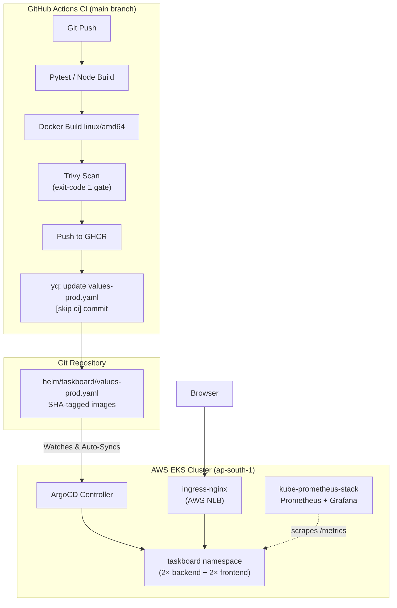

# DevOps Incident & Task Tracker — DevSecOps Capstone

A production-grade **DevSecOps** reference implementation built for the capstone project.
The application is a full-stack incident and task tracking board demonstrating the complete
DevSecOps lifecycle: containerised FastAPI + React, automated CI/CD via GitHub Actions,
container security scanning with Trivy, infrastructure-as-code with Terraform on AWS,
GitOps delivery via ArgoCD, and live observability with Prometheus + Grafana.

---

## Architecture



---

## Tech Stack

| Layer | Technology |
|-------|-----------|
| **Backend API** | FastAPI 0.115 + SQLAlchemy 2 + Alembic + PostgreSQL 16 |
| **Frontend** | React 18 + Vite 6 + nginx-unprivileged (non-root) |
| **Containerisation** | Docker multi-stage builds (`linux/amd64`), Docker Compose |
| **CI/CD** | GitHub Actions — 2-stage pipeline (test → build/scan/push) |
| **Security Scanning** | Aqua Security Trivy (HIGH/CRITICAL gate, `exit-code 1`) |
| **Registry** | GitHub Container Registry (GHCR) with immutable SHA tags |
| **Infrastructure** | Terraform ≥ 1.7 — AWS VPC + EKS (ap-south-1) |
| **Kubernetes** | EKS 1.31, Helm 3, NGINX Ingress Controller (AWS NLB) |
| **GitOps** | ArgoCD — sole production deployment controller |
| **Observability** | Prometheus Operator (`kube-prometheus-stack`) + Grafana |

---

## Local Development Setup

### Prerequisites

- Docker Desktop running
- Python ≥ 3.12 (for backend tests)
- Node.js 22 (for frontend build)

### Run with Docker Compose

```bash
# Clone and start all services
git clone https://github.com/BYT-Bender/devsecops-python.git
cd devsecops-python
docker compose up --build -d

# Verify services are running
docker compose ps

# Check non-root execution
docker compose exec backend id          # → uid=10001
docker compose exec frontend id         # → uid=101 (nginx-unprivileged)
```

| URL | Service |
|-----|---------|
| `http://localhost:3000` | React frontend (DevOps Incident Board UI) |
| `http://localhost:8000/api/tasks` | FastAPI task list (JSON) |
| `http://localhost:8000/docs` | Swagger / OpenAPI docs |
| `http://localhost:8000/health` | Health check |
| `http://localhost:8000/metrics` | Prometheus metrics |

---

## API Endpoints

| Method | Path | Description |
|--------|------|-------------|
| GET | `/health` | Liveness check → `{"status": "UP"}` |
| GET | `/ready` | Readiness check (DB ping) → `{"status": "READY"}` |
| GET | `/api/tasks` | List all tasks (ordered newest first) |
| POST | `/api/tasks` | Create a task (`title`, `description`, `priority`, `assignee`, `status`) |
| GET | `/api/tasks/{id}` | Get a single task |
| PUT | `/api/tasks/{id}` | Update a task (partial update) |
| DELETE | `/api/tasks/{id}` | Delete a task (204 No Content) |
| GET | `/api/tasks/stats` | Aggregated counts by status |
| GET | `/metrics` | Prometheus instrumentation metrics |

**Task schema**

```json
{
  "title": "Configure EKS Ingress",
  "description": "Set up NGINX ingress controller with NLB",
  "priority": "HIGH",        // LOW | MEDIUM | HIGH
  "status": "TODO",          // TODO | IN_PROGRESS | DONE
  "assignee": "DevOps Engineer"
}
```

---

## Testing Suite

Tests use an isolated SQLite database — no PostgreSQL required.

```bash
cd backend
pip install -r requirements.txt
pytest -v
```

**10 test cases across 5 endpoints:**

| Test | Endpoint | Assertion |
|------|----------|-----------|
| `test_health_check` | GET `/health` | 200 `{"status":"UP"}` |
| `test_ready_check` | GET `/ready` | 200 `{"status":"READY"}` |
| `test_create_task` | POST `/api/tasks` | 201, task returned |
| `test_create_task_invalid_missing_title` | POST `/api/tasks` | 422 validation error |
| `test_create_task_invalid_bad_priority` | POST `/api/tasks` | 422 validation error |
| `test_list_tasks` | GET `/api/tasks` | 200, list with items |
| `test_get_task_by_id` | GET `/api/tasks/{id}` | 200, exact task |
| `test_get_task_not_found` | GET `/api/tasks/9999` | 404 |
| `test_update_task_status` | PUT `/api/tasks/{id}` | 200, status updated |
| `test_delete_task` | DELETE `/api/tasks/{id}` | 204, then 404 |

---

## CI/CD Pipeline Architecture

The pipeline runs in **2 stages** on every event:

### Stage 1 — `test` (all events: push, PR, dispatch)

1. Installs Python 3.12 + pip dependencies
2. Runs `pytest -v` (all 10 tests must pass — pipeline fails otherwise)
3. Builds Node 22 frontend (`npm ci && npm run build`)

### Stage 2 — `build-scan-push` (main branch pushes/dispatch only)

1. **Normalises image names** to lowercase once:
   `ghcr.io/byt-bender/taskboard-backend` and `ghcr.io/byt-bender/taskboard-frontend`
2. **Builds** `linux/amd64` Docker images tagged with the immutable Git commit SHA
3. **Trivy scans** both images with `--severity HIGH,CRITICAL --ignore-unfixed --exit-code 1`
4. **Pushes** SHA-tagged images to GHCR
5. **GitOps update**: pinned `yq v4.44.3` updates `helm/taskboard/values-prod.yaml` with the new SHA tags, verifies them, and commits `[skip ci]` to main

---

## Security Scanning (Trivy — M6)

Trivy container scanning is enforced in CI with a **hard gate**: the pipeline fails if any
**HIGH or CRITICAL** vulnerability is found in a fixable package (`--ignore-unfixed`).

```yaml
- name: Trivy Vulnerability Scan (Backend)
  uses: aquasecurity/trivy-action@v0.36.0
  with:
    image-ref: ${{ env.BACKEND_IMAGE }}:${{ env.IMAGE_TAG }}
    severity: 'HIGH,CRITICAL'
    ignore-unfixed: true
    exit-code: '1'        # ← hard gate: pipeline fails on findings
```

### CVE Discussion

Base image: `python:3.12-slim` (backend) and `nginxinc/nginx-unprivileged:alpine` (frontend).

The first CI scan found three HIGH vulnerabilities in Starlette `0.41.3`:

- **CVE-2025-62727**: inefficient parsing of crafted HTTP `Range` headers can cause denial of service in `FileResponse`. Fixed in Starlette `0.49.1`.
- **CVE-2026-48818**: a Windows `StaticFiles` path issue can cause SSRF and NTLM credential theft. Fixed in Starlette `1.1.0`.
- **CVE-2026-54283**: URL-encoded form limits were not enforced, creating a denial-of-service risk. Fixed in Starlette `1.3.1`.

The dependency pins now use FastAPI `0.143.2` with Starlette `1.3.1`, which includes fixes for these findings. The Trivy gate remains enabled; the next CI run must confirm the updated images scan cleanly before they are pushed to GHCR. The app does not use Starlette's `FileResponse`, Windows `StaticFiles`, or URL-encoded form parsing, but the vulnerable dependency was still present and flagged by the image scan.

The Trivy gate runs on the exact locally built lowercase image tags to avoid Docker Hub pull errors (the critical fix described in this plan).

---

## Terraform Infrastructure as Code (M7)

The `terraform/` directory provisions a production-ready AWS environment in `ap-south-1`.

### Structure

```
terraform/
├── versions.tf              # Terraform + AWS provider version constraints
├── variables.tf             # Input variables (region, cluster_name, environment)
├── main.tf                  # VPC + EKS module declarations with resource tags
├── outputs.tf               # Cluster name, endpoint, VPC ID
└── terraform.tfvars.example # Safe example variable file (copy → terraform.tfvars)
```

### Resources Provisioned

| Resource | Details |
|----------|---------|
| **VPC** | `10.20.0.0/16` with 2 public + 2 private subnets across `ap-south-1a/b` |
| **NAT Gateway** | Single NAT for private subnet egress |
| **EKS Cluster** | Kubernetes 1.31, public API endpoint |
| **Node Group** | `t3.medium` × 2–4 nodes (auto-scaling) |

### Usage

```bash
cd terraform

# Copy and edit variable file (never commit terraform.tfvars)
cp terraform.tfvars.example terraform.tfvars

# Initialise providers and modules
terraform init

# Review planned changes (~50 resources)
terraform plan -var-file=terraform.tfvars

# ⚠️ HUMAN APPROVAL REQUIRED before apply
# terraform apply incurs AWS charges (~$0.10/hr EKS + EC2 costs)
terraform apply -var-file=terraform.tfvars

# Clean up immediately after screenshots
terraform destroy -var-file=terraform.tfvars
```

> [!CAUTION]
> **Cost Warning**: `terraform apply` provisions real AWS infrastructure that incurs billing.
> Always run `terraform destroy` immediately after capturing required screenshots.

---

## Kubernetes & Helm Deployment (M8)

### Helm Chart Structure

```
helm/taskboard/
├── Chart.yaml
├── values.yaml               # Default values (GHCR images, dev settings)
├── values-prod.yaml          # Production overrides (SHA tags, 2 replicas, Ingress enabled)
└── templates/
    ├── backend-deployment.yaml
    ├── backend-service.yaml
    ├── frontend-deployment.yaml
    ├── frontend-service.yaml
    ├── ingress.yaml           # Ingress: /api → backend:8000, / → frontend:80
    ├── postgres.yaml
    ├── hpa.yaml
    └── servicemonitor.yaml
```

### Install NGINX Ingress Controller (AWS NLB)

```bash
helm repo add ingress-nginx https://kubernetes.github.io/ingress-nginx
helm repo update
helm upgrade --install ingress-nginx ingress-nginx/ingress-nginx \
  --namespace ingress-nginx --create-namespace \
  --set controller.service.annotations."service\.beta\.kubernetes\.io/aws-load-balancer-type"="nlb" \
  --set controller.service.annotations."service\.beta\.kubernetes\.io/aws-load-balancer-scheme"="internet-facing" \
  --wait
```

### Isolated Helm Validation (M8 Rubric Check)

```bash
# Lint
helm lint ./helm/taskboard

# Dry-run template render
helm template taskboard-helm-test ./helm/taskboard \
  -f ./helm/taskboard/values-prod.yaml \
  --set monitoring.serviceMonitor.enabled=false

# Install to isolated test namespace
helm upgrade --install taskboard-helm-test ./helm/taskboard \
  --namespace taskboard-test --create-namespace \
  -f ./helm/taskboard/values-prod.yaml \
  --set monitoring.serviceMonitor.enabled=false

# Verify and clean up
kubectl get pods,svc,ingress -n taskboard-test
helm uninstall taskboard-helm-test --namespace taskboard-test
kubectl delete namespace taskboard-test
```

> [!IMPORTANT]
> Never run direct Helm installs against the production `taskboard` namespace.
> That namespace is **exclusively owned by ArgoCD**.

---

## GitOps with ArgoCD (Sole Production Deployment Controller)

ArgoCD is the **only** component that deploys to the production `taskboard` namespace.
GitHub Actions never touches the live cluster.

### Install ArgoCD

```bash
kubectl create namespace argocd
kubectl apply -n argocd -f \
  https://raw.githubusercontent.com/argoproj/argo-cd/stable/manifests/install.yaml
```

### Deploy the Application

```bash
# Apply ArgoCD Application CRD
kubectl apply -f k8s/argocd-application.yaml

# Access ArgoCD UI
kubectl port-forward svc/argocd-server -n argocd 8080:443
# Open https://localhost:8080
# Username: admin | Password: kubectl -n argocd get secret argocd-initial-admin-secret -o jsonpath="{.data.password}" | base64 -d
```

ArgoCD watches `helm/taskboard` on the `main` branch and syncs automatically when CI
commits new SHA tags to `values-prod.yaml`. Sync is automated with `prune: true` and
`selfHeal: true`.

---

## Observability (M9)

### Install kube-prometheus-stack

```bash
helm repo add prometheus-community https://prometheus-community.github.io/helm-charts
helm repo update
helm upgrade --install kube-prometheus-stack prometheus-community/kube-prometheus-stack \
  --namespace monitoring --create-namespace \
  -f monitoring/prometheus-values.yaml \
  --wait

# Apply auto-provisioned Grafana dashboard
kubectl apply -f monitoring/grafana-dashboard-configmap.yaml
```

### Verify Prometheus Target Discovery

```bash
kubectl get servicemonitor -n taskboard
kubectl port-forward svc/kube-prometheus-stack-prometheus -n monitoring 9090:9090
# Open http://localhost:9090/targets
# Locate: serviceMonitor/taskboard/taskboard-taskboard-backend/0 → Status: UP
```

### Access Grafana Dashboard

```bash
kubectl port-forward svc/kube-prometheus-stack-grafana -n monitoring 3001:80
# Open http://localhost:3001  (admin / admin)
# Navigate to: Dashboards → TaskBoard Application Performance
```

**4 panels automatically provisioned** via ConfigMap sidecar (no manual import):
- FastAPI HTTP Request Rate (RPS)
- FastAPI p95 Request Latency (seconds)
- FastAPI 4xx / 5xx HTTP Errors
- Total API Tasks Handled

---

## Troubleshooting Guide

| Symptom | Likely Cause | Resolution |
|---------|-------------|------------|
| `ImagePullBackOff` on EKS | GHCR package is private | Set package visibility to **Public** in GitHub Package Settings, or create `imagePullSecrets` |
| Frontend returns `502 Bad Gateway` | Backend pod not ready | Check `kubectl get pods -n taskboard`; wait for backend readiness probe to pass |
| `503 Service Unavailable` via Ingress | `ingress-nginx` not installed | Run `helm upgrade --install ingress-nginx ...` (Task 5.4) |
| `no matches for kind "ServiceMonitor"` | Prometheus Operator CRDs absent | Run isolated Helm test with `--set monitoring.serviceMonitor.enabled=false` |
| `pytest` failures in CI | DB dependency issue | `conftest.py` overrides `get_db` with SQLite; ensure `DATABASE_URL` env var is set before imports |
| Grafana dashboard not appearing | Sidecar label mismatch | Confirm ConfigMap has `grafana_dashboard: "1"` label and sidecar values are applied |
| ArgoCD shows `OutOfSync` | `values-prod.yaml` tag mismatch | Trigger CI pipeline on `main`; verify `yq` update step completed successfully |
| `terraform plan` fails | Missing AWS credentials | Configure `aws configure` with IAM credentials for `ap-south-1` |

---

## Repository Structure

```
devsecops-python/
├── .github/workflows/ci-cd.yml   # 2-stage CI/CD pipeline
├── backend/                       # FastAPI application
│   ├── app/
│   │   ├── main.py               # Routes and endpoints
│   │   ├── models.py             # SQLAlchemy Task model
│   │   ├── schemas.py            # Pydantic schemas
│   │   ├── db.py                 # Database engine + session
│   │   └── config.py             # Settings via pydantic-settings
│   ├── alembic/                  # Database migrations
│   ├── tests/
│   │   ├── conftest.py           # Fixtures (SQLite DB, TestClient)
│   │   └── test_api.py           # 10 comprehensive test cases
│   ├── Dockerfile                # Multi-stage, non-root UID 10001
│   └── requirements.txt
├── frontend/                      # React + Vite application
│   ├── src/
│   │   ├── main.jsx              # App component (DevOps Incident Board)
│   │   └── styles.css
│   ├── Dockerfile                # Multi-stage, nginx-unprivileged (UID 101, port 8080)
│   └── nginx.conf                # Listens on 8080, proxies /api to backend:8000
├── helm/taskboard/               # Helm chart
│   ├── templates/                # Kubernetes manifests (Ingress fixed: /api → :8000)
│   ├── values.yaml               # Default values
│   └── values-prod.yaml          # Production overrides (SHA tags, updated by CI)
├── k8s/                          # Standalone Kubernetes manifests
│   ├── argocd-application.yaml   # ArgoCD Application CRD
│   ├── deployment.yaml
│   ├── service.yaml
│   └── namespace.yaml
├── monitoring/
│   ├── prometheus-values.yaml    # kube-prometheus-stack Helm values (sidecar enabled)
│   ├── grafana-dashboard.json    # Standalone dashboard source JSON
│   └── grafana-dashboard-configmap.yaml  # Auto-provisioned via sidecar
├── terraform/                    # AWS VPC + EKS infrastructure
│   ├── main.tf
│   ├── variables.tf
│   ├── outputs.tf
│   ├── versions.tf
│   └── terraform.tfvars.example
└── docker-compose.yml            # Local development stack
```
